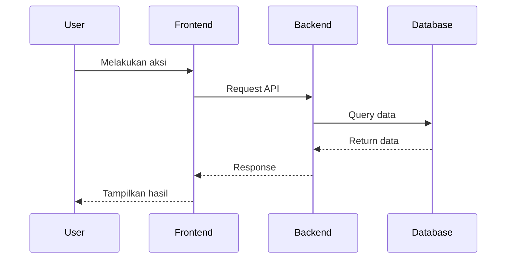

# Documentation Standards

## Tujuan
Membuat dokumentasi profesional untuk setiap fungsi dan/atau fitur sesuai dengan kegunaannya dengan struktur file dokumentasi yang terstruktur dengan baik dan mengikuti standard penulisan dokumentasi.

## Struktur Folder Dokumentasi

Setiap project **HARUS** memiliki folder `docs/` di root dengan struktur:

```
docs/
├── README.md                    # Overview project
├── GETTING_STARTED.md          # Quick start guide
├── INSTALLATION.md             # Setup & installation
├── CONFIGURATION.md            # Configuration guide
├── ARCHITECTURE.md             # System architecture
├── api/
│   ├── README.md              # API overview
│   ├── authentication.md      # Auth documentation
│   ├── endpoints/
│   │   ├── users.md
│   │   ├── products.md
│   │   └── orders.md
│   └── collection.json        # Postman/Insomnia
├── openapi/
│   ├── openapi.yaml           # OpenAPI spec
│   └── schemas/
├── database/
│   ├── ERD.png                # Entity Relationship Diagram
│   ├── schema.md              # Database schema doc
│   └── migrations.md          # Migration guide
├── features/
│   ├── authentication.md
│   ├── payment-processing.md
│   └── notification-system.md
├── guides/
│   ├── development.md         # Dev guide
│   ├── testing.md             # Testing guide
│   ├── deployment.md          # Deployment guide
│   ├── troubleshooting.md     # Common issues
│   └── user-guide-admin.md    # Admin panel guide (end-user)
├── executive/                  # Untuk stockholders / eksekutif
│   ├── OVERVIEW.md            # Non-technical project overview
│   ├── FEATURES.md            # Feature catalog with business value
│   └── ROADMAP.md             # Timeline & milestones
├── onboarding/                 # Untuk new hire
│   └── CHECKLIST.md           # Step-by-step onboarding guide
└── changelog/
    └── CHANGELOG.md           # Version history
```

## Persona-Based Documentation

Setiap project memiliki audiens yang berbeda. Dokumentasi harus disusun sesuai kebutuhan masing-masing persona.

### Profil Audiens

| Persona | Kebutuhan | Fokus |
|---------|-----------|-------|
| **End-User (Admin/Editor)** | Panduan input data, mapping halaman admin → frontend, field-by-field guide | Praktis, visual, non-teknis |
| **Developer** | Arsitektur, API, database, coding standards, testing, deployment | Teknis, detail, kode |
| **Stockholder/Executive** | Gambaran besar project, business value, fitur unggulan, roadmap | Non-teknis, strategis |
| **DevOps/Sysadmin** | Deployment, infrastructure, environment variables, monitoring, backup | Operasional, konfigurasi |
| **Onboarding (New Hire)** | Setup lingkungan dev, tech stack primer, contribution guide | Step-by-step, ramah pemula |

### Dokumen per Persona

| Persona | WAJIB | Opsional |
|---------|-------|----------|
| **End-User** | `guides/user-guide-admin.md` | FAQ, video tutorial |
| **Developer** | `ARCHITECTURE.md`, `GETTING_STARTED.md`, `api/`, `database/`, `guides/development.md`, `guides/testing.md` | `guides/troubleshooting.md` |
| **Stockholder** | `executive/OVERVIEW.md`, `executive/FEATURES.md`, `executive/ROADMAP.md` | Slide deck, one-pager |
| **DevOps** | `INSTALLATION.md`, `CONFIGURATION.md`, `guides/deployment.md` | Infra diagram, runbook |
| **Onboarding** | `GETTING_STARTED.md`, `onboarding/CHECKLIST.md` | Tech stack primer |

### End-User Admin Guide — Konten Minimal

```markdown
# Panduan Pengguna Admin Panel

## Daftar Menu
Tabel mapping: menu admin → frontend page/component

## Per-Menu Guide
Untuk setiap menu:
- Nama menu & akses
- Field-by-field: nama, tipe, required, contoh, dampak ke frontend
- Tips pengisian (bilingual, cache, soft delete)

## Ringkasan Cepat
"Ini mau ubah A → buka menu B"
```

### Executive Summary — Konten Minimal

```markdown
# Executive Overview

## Ringkasan Project
Apa yang dibangun, untuk siapa, masalah apa yang diselesaikan.

## Fitur Unggulan
- Fitur 1: nilai bisnis, benefit untuk user
- Fitur 2: nilai bisnis, benefit untuk user

## Tech Stack (high-level)
Backend, frontend, database, infrastructure.

## Milestone & Timeline
- Q1 2025: fase 1 (MVP)
- Q2 2025: fase 2 (enhancement)
- Q3 2025: fase 3 (scale)

## Metrik Keberhasilan
- Traffic, conversion, user adoption, dll.
```

### Onboarding Checklist — Konten Minimal

```markdown
# Onboarding Checklist

## Prasyarat
- Akun, akses, tools yang perlu diinstall

## Step 1: Setup Lingkungan
- Clone repo, install dependencies, setup env

## Step 2: Menjalankan Project
- Dev server, database migration, seed

## Step 3: Memahami Codebase
- Folder structure, design patterns, data flow

## Step 4: Workflow Tim
- Git branching, code review, deployment

## Referensi
- Link ke dokumentasi lebih lanjut
```

## Template Dokumentasi

### 1. README.md (Root Project)

```markdown
# Nama Project

Deskripsi singkat tentang project ini dan tujuan utamanya.

## Fitur Utama

- Fitur 1: Deskripsi singkat
- Fitur 2: Deskripsi singkat
- Fitur 3: Deskripsi singkat

## Tech Stack

- **Backend**: PHP 8.2, Laravel 10
- **Frontend**: React 18, TypeScript
- **Database**: PostgreSQL 15
- **Cache**: Redis 7
- **Queue**: RabbitMQ

## Requirements

- PHP >= 8.2
- Composer >= 2.5
- Node.js >= 18
- PostgreSQL >= 15
- Redis >= 7

## Quick Start

```bash
# Clone repository
git clone https://github.com/username/project-name.git
cd project-name

# Install dependencies
composer install
npm install

# Setup environment
cp .env.example .env
php artisan key:generate

# Run migrations
php artisan migrate --seed

# Start development server
php artisan serve
npm run dev
```

## Dokumentasi

- [Getting Started](docs/GETTING_STARTED.md)
- [Installation Guide](docs/INSTALLATION.md)
- [API Documentation](docs/api/README.md)
- [Architecture](docs/ARCHITECTURE.md)

## License

MIT License
```

### 2. Feature Documentation Template

```markdown
# Nama Fitur

## Deskripsi

Penjelasan lengkap tentang fitur ini, tujuannya, dan use case.

## Alur Proses



## Komponen Terkait

### Backend
- **Controller**: `App\Http\Controllers\FeatureController`
- **Service**: `App\Services\FeatureService`
- **Model**: `App\Models\Feature`
- **Repository**: `App\Repositories\FeatureRepository`

### Frontend
- **Component**: `src/components/Feature/FeatureComponent.tsx`
- **Service**: `src/services/featureService.ts`
- **Store**: `src/store/featureStore.ts`

### Database
- **Tables**: `features`, `feature_logs`
- **Migration**: `2024_01_15_create_features_table.php`

## API Endpoints

### Create Feature
```
POST /api/v1/features
```

**Request Body:**
```json
{
  "name": "Feature Name",
  "description": "Feature description",
  "is_active": true
}
```

**Response:**
```json
{
  "success": true,
  "message": "Fitur berhasil dibuat",
  "data": {
    "id": "uuid",
    "name": "Feature Name",
    "created_at": "2024-01-15T10:30:00Z"
  }
}
```

## Konfigurasi

Environment variables yang diperlukan:

```env
FEATURE_ENABLED=true
FEATURE_MAX_ITEMS=100
FEATURE_CACHE_TTL=3600
```

## Testing

### Unit Tests
```bash
php artisan test --filter FeatureTest
```

### Integration Tests
```bash
php artisan test tests/Feature/FeatureIntegrationTest.php
```

## Known Issues & Limitations

- Issue 1: Deskripsi masalah dan workaround
- Limitation 1: Batasan fitur dan alasannya

## Changelog

### v1.1.0 (2024-01-20)
- Added: Fitur X
- Fixed: Bug Y
- Changed: Behavior Z

### v1.0.0 (2024-01-15)
- Initial release
```

### 3. API Endpoint Documentation Template

```markdown
# [HTTP Method] /api/v1/endpoint

Deskripsi singkat endpoint ini.

## Authentication

Requires: Bearer Token

## Request

### Headers
```
Content-Type: application/json
Authorization: Bearer {token}
```

### Path Parameters
- `id` (UUID, required): ID resource

### Query Parameters
- `page` (integer, optional): Halaman pagination (default: 1)
- `per_page` (integer, optional): Item per halaman (default: 20, max: 100)
- `sort` (string, optional): Field untuk sorting (default: created_at)
- `order` (string, optional): asc atau desc (default: desc)

### Request Body
```json
{
  "field1": "value1",
  "field2": "value2"
}
```

#### Field Validation
| Field | Type | Required | Validation | Description |
|-------|------|----------|------------|-------------|
| field1 | string | Yes | max:255 | Deskripsi field1 |
| field2 | integer | No | min:0, max:100 | Deskripsi field2 |

## Response

### Success Response (200 OK)
```json
{
  "success": true,
  "message": "Operasi berhasil",
  "data": {
    "id": "uuid",
    "field1": "value1"
  }
}
```

### Error Responses

#### 401 Unauthorized
```json
{
  "success": false,
  "message": "Token tidak valid",
  "error_code": "UNAUTHORIZED"
}
```

#### 422 Validation Error
```json
{
  "success": false,
  "message": "Validasi gagal",
  "errors": {
    "field1": ["Field1 wajib diisi"]
  }
}
```

## Examples

### cURL
```bash
curl -X POST https://api.example.com/api/v1/endpoint \
  -H "Content-Type: application/json" \
  -H "Authorization: Bearer your-token" \
  -d '{"field1": "value1"}'
```

### JavaScript (Axios)
```javascript
const response = await axios.post('/api/v1/endpoint', {
  field1: 'value1'
}, {
  headers: {
    'Authorization': `Bearer ${token}`
  }
});
```

### PHP (Guzzle)
```php
$response = $client->post('/api/v1/endpoint', [
    'headers' => [
        'Authorization' => 'Bearer ' . $token,
    ],
    'json' => [
        'field1' => 'value1',
    ],
]);
```
```

## Best Practices untuk Dokumentasi

### 1. Bahasa
- **WAJIB** menggunakan bahasa Indonesia BAKU dan FORMAL
- Ikuti EYD (Ejaan Yang Disempurnakan)
- Konsisten dalam penggunaan istilah teknis
- Hindari bahasa gaul atau singkatan tidak resmi

### 2. Struktur
- Gunakan heading hierarchy yang benar (H1 → H2 → H3)
- Buat table of contents untuk dokumen panjang
- Pisahkan topik dengan jelas
- Gunakan bullet points dan numbering dengan tepat

### 3. Code Snippets
- Selalu include syntax highlighting
- Berikan context sebelum code block
- Include comment untuk explain complex logic
- Provide complete, runnable examples

### 4. Visual Aids
- Gunakan diagram untuk alur kompleks (Mermaid, PlantUML)
- Include screenshots untuk UI/UX documentation
- Buat ERD untuk database documentation
- Use tables untuk comparison atau structured data

### 5. Keep Updated
- Update documentation seiring perubahan code
- Include version number dan tanggal update
- Document breaking changes dengan jelas
- Maintain CHANGELOG.md

### 6. Links & References
- Gunakan relative links untuk internal docs
- Link ke external resources yang relevan
- Pastikan links tidak broken (check regularly)
- Include references untuk third-party libraries

## Dokumentasi dalam Kode

### PHP DocBlock
```php
/**
 * Memproses pembayaran pesanan
 * 
 * Metode ini menangani validasi data pembayaran, komunikasi dengan payment gateway,
 * pembaruan status pesanan, dan pengiriman notifikasi kepada pengguna.
 * 
 * @param string $orderId UUID pesanan yang akan diproses
 * @param array $paymentData Data pembayaran dari payment gateway
 * @param array $options Opsi tambahan untuk pemrosesan
 * 
 * @return Order Model pesanan yang telah diperbarui dengan status pembayaran
 * 
 * @throws PaymentException Jika pembayaran ditolak oleh gateway
 * @throws OrderNotFoundException Jika pesanan dengan ID tersebut tidak ditemukan
 * @throws ValidationException Jika data pembayaran tidak valid
 * 
 * @example
 * ```php
 * $order = $service->processPayment(
 *     '550e8400-e29b-41d4-a716-446655440000',
 *     ['amount' => 100000, 'method' => 'credit_card'],
 *     ['send_notification' => true]
 * );
 * ```
 */
public function processPayment(string $orderId, array $paymentData, array $options = []): Order
{
    // Implementation
}
```

### JavaScript/TypeScript JSDoc
```typescript
/**
 * Menghitung total harga setelah diskon dan pajak
 * 
 * Fungsi ini menerima harga dasar, persentase diskon, dan persentase pajak,
 * kemudian menghitung total akhir yang harus dibayarkan.
 * 
 * @param basePrice - Harga dasar sebelum diskon dan pajak
 * @param discountPercentage - Persentase diskon (0-100)
 * @param taxPercentage - Persentase pajak (0-100)
 * @returns Total harga final setelah diskon dan pajak
 * 
 * @throws {Error} Jika basePrice negatif
 * @throws {RangeError} Jika percentage di luar range 0-100
 * 
 * @example
 * ```typescript
 * const total = calculateTotal(1000, 10, 11);
 * // Returns: 990 (1000 - 10% + 11% pajak dari harga setelah diskon)
 * ```
 */
function calculateTotal(
  basePrice: number,
  discountPercentage: number,
  taxPercentage: number
): number {
  // Implementation
}
```

## Tools untuk Generate Documentation

### API Documentation
- **Swagger/OpenAPI**: Auto-generate dari OpenAPI spec
- **Postman**: Generate dari Postman collection
- **API Blueprint**: Markdown-based API documentation

### Code Documentation
- **PHPDocumentor**: Generate PHP documentation
- **JSDoc**: Generate JavaScript documentation
- **TypeDoc**: Generate TypeScript documentation
- **Doxygen**: Multi-language documentation generator

### Static Site Generators
- **VuePress**: Vue-powered static site generator
- **Docusaurus**: React-based documentation website
- **MkDocs**: Markdown documentation generator
- **GitBook**: Modern documentation platform

## Interactive Documentation Audit Mode

Ketika user meminta untuk setup/menyusun dokumentasi, jalankan workflow interaktif ini:

### Step 1 — Scan Existing Docs

Gunakan `glob` untuk scan folder `docs/` dan identifikasi:
- Dokumen apa yang sudah ada vs missing
- Folder structure yang sudah terbentuk
- Dokumen yang outdated (Cek tanggal di file, jika >30 hari sejak perubahan kode)

### Step 2 — Identifikasi Audiens

Tanya user siapa target pembaca dokumentasi:

```
━━━━━━━━━━━━━━━━━━━━━━━━━━━━━━━━━━━━━━━━━━━
Documentation Audit — Target Audiens

Proyek ini butuh dokumentasi untuk siapa?

Pilihan kamu (bisa pilih lebih dari 1):
[1] ✅ End-User (Admin/Editor)
    — Butuh user guide admin panel + field mapping

[2] ✅ Developer
    — Butuh API, DB, arsitektur, guide dev/test/deploy

[3] ✅ Stockholder/Executive
    — Butuh overview non-teknis, fitur, roadmap

[4] ✅ DevOps/Sysadmin
    — Butuh deployment, env vars, monitoring

[5] ✅ Onboarding (New Hire)
    — Butuh checklist setup + tech stack primer

[6] ✏️ Tulis detail — kustom
━━━━━━━━━━━━━━━━━━━━━━━━━━━━━━━━━━━━━━━━━━━
```

### Step 3 — Deteksi Gap

Cocokkan audiens yang dipilih dengan dokumen yang sudah ada:

```
📋 Gap Analysis:
  ✅ docs/ARCHITECTURE.md — exists
  ✅ docs/guides/development.md — exists
  ❌ docs/guides/user-guide-admin.md — MISSING (needed for End-User)
  ❌ docs/executive/OVERVIEW.md — MISSING (needed for Stockholder)
  ❌ docs/onboarding/CHECKLIST.md — MISSING (needed for Onboarding)
```

### Step 4 — Tanya User

Tampilkan gap dan tanya apakah mau generate:

```
━━━━━━━━━━━━━━━━━━━━━━━━━━━━━━━━━━━━━━━━━━━
Documentation Audit — Generate Missing Docs

Ditemukan 3 dokumen yang belum ada:

[1] docs/guides/user-guide-admin.md
    Template: End-User Admin Guide
    → Mapping menu admin → frontend

[2] docs/executive/OVERVIEW.md
    Template: Executive Summary
    → Non-technical + business value

[3] docs/onboarding/CHECKLIST.md
    Template: Onboarding Checklist
    → Step-by-step new hire setup

Pilihan kamu:
[1] ✅ Generate semua yang missing
[2] ✏️ Pilih manual — tentukan yang mana saja
[3] ❌ Batal — skip audit
━━━━━━━━━━━━━━━━━━━━━━━━━━━━━━━━━━━━━━━━━━━
```

### Step 5 — Generate & Final Report

Jika user setuju, generate dokumen yang missing menggunakan template yang sesuai. Kemudian tampilkan laporan:

```
📋 Documentation Audit Report — Selesai

Generated:
  ✅ docs/guides/user-guide-admin.md — from End-User template
  ✅ docs/executive/OVERVIEW.md — from Executive template
  ✅ docs/onboarding/CHECKLIST.md — from Onboarding template

Next: Update dokumen ini saat ada perubahan fitur/API
```

## Checklist Dokumentasi

Sebelum release atau merge, pastikan:
```
□ Semua persona ter-cover (End-User, Developer, Stockholder, DevOps, Onboarding)
□ README.md ada dan lengkap
□ GETTING_STARTED.md tersedia
□ API documentation complete (semua endpoints)
□ Code comments untuk logic kompleks
□ ERD database tersedia
□ Architecture diagram ada (untuk project besar)
□ CHANGELOG.md up-to-date
□ Tidak ada typo atau grammatical errors
□ All links working
□ Code examples tested dan working
```
